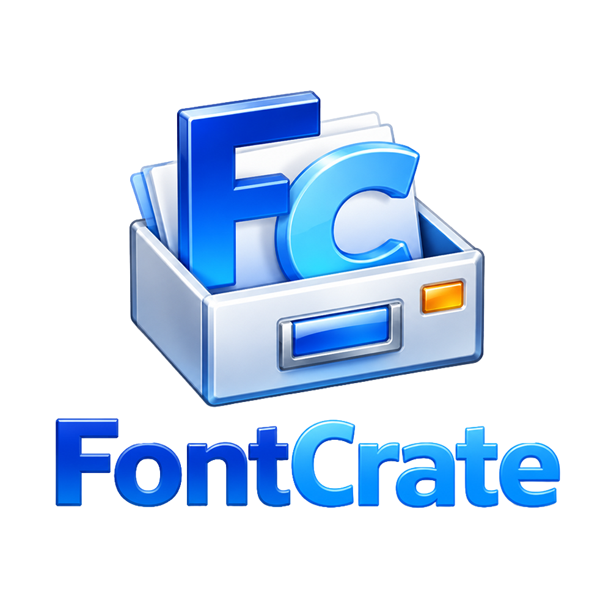

<p align="center">
  
</p>

<h1 align="center">FontCrate</h1>

<p align="center">把字体整理好，需要时再加载。</p>

FontCrate 是面向 Windows 11 x64 的轻量字体管理工具，帮助日常设计中的字体整理、预览和按需使用。

## 为什么开发 FontCrate

这个项目受到 **MainType** 的启发。MainType 提供了丰富、专业的字体管理能力，但对我日常做设计的需求来说，它显得有些重，许多专业功能并不常用。

设计工作需要丰富的字体选择，但每个项目实际用到的字体通常只是其中一部分。大量字体长期处于安装或启用状态，会增加系统和设计软件处理字体的负担；字体菜单的加载、浏览和预览也更容易出现响应变慢或卡顿。[^font-performance]

我的核心需求是围绕设计项目管理字体：集中整理与预览字体资源，根据项目需要启用相应字体，完成后停用。将字体资源库与系统常驻字体分开管理，既能保留完整的字体收藏，也能让工作环境保持精简，让项目用字的选择与切换更高效。

因此，FontCrate 把重点放在 **管理字体和按需加载** 上：字体可以先保存在自己的文件夹中，加入字体库后再预览、分类和挑选，需要时临时启用。目标是让日常设计中的字体使用更简单，而不是把所有收集的字体都变成系统的常驻字体。

## 可以做什么

- **集中管理**：添加一个或多个字体文件夹，在同一个字体库里浏览和搜索。
- **预览与挑选**：输入自己的文字，查看字体效果、字形和字符覆盖，支持多选。
- **整理分类**：用标签、合集和收藏整理风格、用途或项目所需的字体。
- **按需加载**：临时启用选中的字体，供其他软件使用，完成工作后再停用。
- **长期使用**：对经常使用的字体，也可以选择安装到当前 Windows 用户。

目前支持 TTF、OTF、TTC 和 OTC 字体。

## 开始使用

解压 `FontCrate-win-x64.zip`，运行 `FontCrate.exe`。自包含运行包已带有 .NET 运行时，无需另行安装，也不要求管理员权限。

1. **添加字体**：点击“添加目录”，选择存放字体的文件夹，等待扫描完成。加入字体库不会自动把字体安装到系统。
2. **找到合适的字体**：在字体库中搜索名称，或按来源、标签、合集、收藏和状态筛选。输入实际要排版的文字，比较预览效果。
3. **整理项目用字**：给字体添加标签，或建立一个合集，例如“海报标题”“正文阅读”“某个品牌项目”，方便下次查找。
4. **需要时启用**：选中一个或多个字体，点击“临时启用”，然后在设计软件中选择这些字体。部分软件会缓存字体列表，可能需要重新打开软件才能看到。
5. **用完后停用**：点击“停用临时字体”，或选择“退出并停用临时字体”。字体原文件和分类信息会保留，下次需要时再启用。

例如，为一张海报挑选字体时，可以先建立项目合集，只临时启用本次要使用的几款字体；完成后停用，字体仍留在库里，不必为了每个项目不断安装和卸载。

## 临时启用与安装

| 操作 | 适合的场景 | 使用结束后 |
|---|---|---|
| 临时启用 | 当前设计任务、试字、偶尔使用的字体 | 可以手动停用；正常完全退出时会停用 |
| 安装 | 希望长期可用的常用字体 | 退出 FontCrate 后仍保持安装 |

最小化到托盘会继续保持临时字体启用，完全退出才会停用。TTC / OTC 字体集合按整个文件启用或停用。

FontCrate 的卸载只处理它自己安装的字体；移除来源或删除标签、合集不会删除原始字体文件。字体文件发生变化后，可在“来源管理”中执行“增量扫描”；详细操作见 [使用说明](docs/USAGE.zh-CN.md)。

## 当前进展

项目处于开发与验证阶段，已通过 Linux 环境下的 Release 构建和 106 项自动化测试。Windows 原生界面、字体渲染、跨应用启用与性能仍待验收，当前运行包为待验收构建。按需加载是项目的设计目标，实际性能改善尚未测量。

验证情况与步骤见 [验收文档](docs/VALIDATION.zh-CN.md)。

## 简单的技术说明

使用 C#、.NET 10 和 WPF 构建，配合 SQLite 保存字体库信息、DirectWrite 处理字体预览。FontCrate 独立实现字体管理功能。

安装 .NET 10 SDK 后，可在仓库根目录构建和测试；运行应用需要 Windows：

```powershell
dotnet build FontCrate.sln -c Release
dotnet test tests/FontCrate.Tests/FontCrate.Tests.csproj -c Release
dotnet run --project src/FontCrate.App
```

生成自包含发布包：

```powershell
powershell -ExecutionPolicy Bypass -File tools/publish.ps1
```

## 作者与许可证

作者：**Hwangzhun** · [GitHub 仓库](https://github.com/hwangzhun/FontCrate)。项目采用 [GNU GPL v3（GPL-3.0-only）](LICENSE)；第三方组件说明见 [THIRD-PARTY-NOTICES.md](THIRD-PARTY-NOTICES.md)。

[^font-performance]: [MainType 官方手册](https://www.high-logic.com/maintype/manual13/fm_install_and_load_fonts.html)指出，系统性能受到活动字体数量的影响，并建议按需加载字体；[Adobe Fonts 官方说明](https://helpx.adobe.com/fonts/web/getting-and-using-fonts/managing-fonts.html)建议移除不再使用的字体，以缩短字体菜单并改善性能。[Adobe 的 Illustrator CS3 故障排查文档](https://helpx.adobe.com/archive/illustrator/illustrator-cs3-troubleshooting.pdf)也说明了安装字体数量与字体菜单显示耗时的关系，该文档适用于旧版软件。
